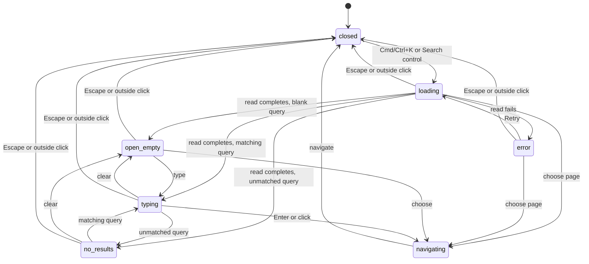

# Quick switcher

Card: WR617.S11.J3

Ask Doc opens the chat page from the shared top bar when the partner signs in through the engine.
The global switcher opens with Cmd+K on a Mac and Ctrl+K elsewhere, from any page,
including from a text field. On a Mac, Ctrl+K stays the text fields' delete to end
of line. Its button advertises the shortcut for its platform. Cmd/Ctrl+Alt+K
was dropped because partners expect plain Cmd/Ctrl+K, and the old Control Room
that used it is retired.
The handler uses physical KeyK.
Composition events, including keyCode 229, and AltGraph pass through. Printable
Ctrl+Alt characters in editable fields also pass through. Composing Enter
never chooses a destination.

The switcher is a lazy island over the authorized board, relationship network
and navigation registry. Recents retain only destination IDs in session storage
and intersect them with fresh reads. Labels are never persisted.

Close always restores the opener. Session invalidation closes and retires the
island, clears recents and discards late reads. New opens revalidate data.
Arrow keys wrap while focus stays on the combobox. Native dialog excludes background Tab targets.

Two designs were considered. The full Search page preserves broad search but
its producer does not supply navigable deal links. The chosen local index gives
instant filtering over existing navigable reads without a new server contract.
Board actions supply task destinations. A task reads "<what to do> · <record>" and drops the record when it
matches the task's own wording, so no row repeats a name. Contacts that share a
name each add their role and city, as the picker rule does (ruling 35(6)). Leads open their drawer on Leads, clients and vendors open
their directory record, and other contacts open their relationship node.
The model excludes transport and destination authorization checks, which remain
with the authenticated adapters and destination pages.

Named regression coverage in `test/quick-switcher-browser.test.mjs`:

- `held read completes with needle/absent query and clears to pages` covers delayed matching, delayed no-results and clearing to pages.
- `<phase> closes with Escape/outside and restores focus` covers both close paths in loading, error, open_empty, typing and no_results.
- `loading/error page result navigates with Enter` covers available page navigation before a successful record read.
- `arrow selection wraps exactly and Tab excludes background controls` covers both arrow directions, wrapping and focus containment.
- `global switcher preserves <variant> text entry` covers AltGraph, printable editable fields and both composition signals.
- `composing Enter preserves switcher before normal Enter` covers the composition self-transition and ordinary navigation afterward.

## Exact task destinations

Board tasks use the producer-owned `item_id` from `local-deals-board.v2` 2.1.0.
The pinned producer is CARR `599669d7a144355f5e205ef95c264354629f6acf`.
The switcher passes that identity to `recordRoutes.card` for both pointer and
Enter selection. Recents use the same canonical identity, so next actions and
call follow-ups remain distinct even when their table-local UUIDs collide.
Missing identities reject the board section. No prefix is inferred from a UUID.
Home owns card content and its explicit outside-snapshot message.

The browser regression covers two tasks from one deal at 390 and 1440 pixels
in light and dark themes. The recorded producer actions in
`test/fixtures/deal-board-actions.v2.json` come from the registered producer's
Postgres test and pass the copied action schema and production live-client
parser. Both action source types reach their exact Home row, or Home's existing
unavailable message when the snapshot omits them.

The [task destination statechart](../statecharts/task-destinations/task-destinations.mmd)
models selection and Home's response. Its README maps every transition to tests.
